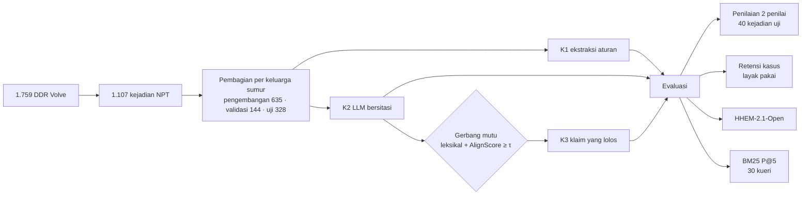

# Workslop on the Rig Floor

**Evaluasi verifikasi dan penyaringan klaim LLM berbasis *daily drilling report* (DDR) untuk mutu *lessons learned* *non-productive time* (NPT)**

Kode, data olahan, dan lembar penilaian untuk full paper **Indonesia Knowledge Management Summit (IKMS) 2026**, subtema *Knowledge Management, Collective Intelligence for Energy*.

> **English summary.** We test whether a source-grounded quality gate (lexical check + AlignScore) can filter unsupported claims from LLM-generated lessons learned built from 1,107 NPT events in the public Volve drilling reports. Success criteria were fixed before testing. **None of the four criteria was met**: the gate cut unsupported claims from 37.6% to 30.5% (not significant, p = 0.059), kept only 65.0% of usable cases, correlated weakly with human labels (ρ = 0.16), and lowered retrieval precision@5. The repository contains the full pipeline, rater sheets, and analysis so the negative result can be checked and reused as an acceptance-test protocol.

---

## Daftar isi

- [Ringkasan penelitian](#ringkasan-penelitian)
- [Hasil utama](#hasil-utama)
- [Isi repositori](#isi-repositori)
- [Cara menjalankan ulang](#cara-menjalankan-ulang)
- [Alur notebook](#alur-notebook)
- [Data dan lisensi Volve](#data-dan-lisensi-volve)
- [Keterbatasan](#keterbatasan)
- [Tim penulis](#tim-penulis)
- [Sitasi](#sitasi)

---

## Ringkasan penelitian

*Large language model* (LLM) dapat merangkum DDR menjadi entri *lessons learned* yang rapi dan bersitasi, tetapi sitasi tidak menjamin klaimnya didukung sumber. Penelitian ini menguji apakah **gerbang mutu** yang menyaring klaim berdasarkan sumbernya mampu menjaga mutu basis kasus NPT.

Tiga kondisi dibandingkan pada kejadian NPT yang sama:

| Kondisi | Deskripsi |
|---|---|
| **K1** | Ekstraksi berbasis aturan: kalimat DDR berkata kunci masalah atau tindakan disalin apa adanya (maks. 6 kalimat) |
| **K2** | LLM dengan sitasi wajib: Qwen2.5-7B-Instruct (4-bit, Ollama, lokal), *temperature* 0, keluaran JSON berisi masalah, penyebab, tindakan, hasil, pelajaran, dan fakta kunci |
| **K3** | K2 yang disaring gerbang mutu: klaim fakta lolos bila angka dan nama peralatannya ada di kalimat sumber **dan** AlignScore ≥ τ (τ = 0,94) |



Empat kriteria keberhasilan ditetapkan **sebelum** data uji diolah:

1. Reduksi relatif klaim tidak didukung *R* ≥ 50% dan *p* < 0,05 (K3 terhadap K2)
2. Retensi kasus layak pakai *Ret* ≥ 90%
3. Korelasi Spearman AlignScore dengan label penilai ρ ≥ 0,6
4. P@5 K3 > K2 dengan *p* < 0,05

---

## Hasil utama

**Tidak satu pun dari empat kriteria tercapai.** Hasil ini dilaporkan apa adanya; ambang τ dan definisi ukuran tidak diubah setelah hasil diketahui.

| Kriteria | Target | Hasil | Status |
|---|---|---|---|
| 1. Reduksi klaim tidak didukung | *R* ≥ 50%, *p* < 0,05 | *R* = 18,8% (IK95% 3,7–35,7), *p*<sub>Holm</sub> = 0,059 | ❌ |
| 2. Retensi kasus layak pakai | ≥ 90% | 65,0% (IK95% 58,9–70,7; *n* = 246) | ❌ |
| 3. Korelasi AlignScore–penilai | ρ ≥ 0,6 | ρ = 0,16 (*n* = 196 klaim) | ❌ |
| 4. P@5 K3 > K2 | naik, *p* < 0,05 | 0,48 → 0,37 (*p* = 0,004, arah berlawanan) | ❌ |

Proporsi klaim tidak didukung per kejadian (*U*), label akhir dua penilai:

| Kondisi | *U* | *n* kejadian | HHEM tidak konsisten | P@5 |
|---|---|---|---|---|
| K1 aturan | 13,9% | 38 | 0,0% | 0,42 |
| K2 LLM bersitasi | 37,6% | 40 | 30,8% | 0,48 |
| K3 K2 + gerbang | 30,5% | 40 | 20,6% | 0,37 |

Friedman χ² = 22,61 (*n* = 38, *p* < 0,001). Kesepakatan antarpenilai biner κ = 0,63 pada 413 klaim.

**Temuan diagnostik (eksploratif):** gerbang membuang 25 dari 29 galat berupa isi tidak didukung atau keluaran rusak, tetapi kedua jenis itu hanya seperempat dari 117 galat K2. Sisanya berupa salah peran (isi benar, bagian keliru), omisi (“unknown” padahal informasinya tertulis), dan pelajaran yang berasumsi, yang tidak terjangkau pencocokan klaim dengan sumber. Tidak ada τ antara 0 dan 0,99 yang memenuhi kriteria 1 dan 2 sekaligus.

Angka lengkap ada di naskah IKMS 2026 (lihat [Sitasi](#sitasi)).

---

## Isi repositori

```
LLM-IKMS/
├── IKMS_2026_Eksperimen.ipynb      Notebook Google Colab: seluruh pipeline, beserta keluaran run 13 Nov 2026
├── README.md
└── Data/
    ├── ikms_paket.zip              Paket masukan notebook (lihat di bawah)
    ├── Lembar_Label_Tau.xlsx       Label 53 klaim validasi untuk kalibrasi ambang τ
    ├── Lembar_Penilai_Utama_Muhammad Reyvan Adrian.xlsx       Label Penilai 2 (sebelum diskusi)
    ├── Lembar_Penilai_Utama_terisi_Muhammad Arzaq Kafabih.xlsx Label Penilai 1 (sebelum diskusi)
    └── Diskusi_Klaim_Berbeda_final.xlsx   Label akhir 101 klaim yang labelnya berbeda
```

Isi `Data/ikms_paket.zip`:

| Berkas | Isi |
|---|---|
| `ikms_lib.py` | Pustaka pipeline: *prompt* dan pemanggil K2, tabel klaim, cek leksikal, gerbang mutu, pemilihan τ, retensi, BM25 P@5, akurasi fakta kunci, pembuat lembar penilai, κ, Holm, *bootstrap*, dan analisis akhir |
| `data/events.parquet` | 1.107 kejadian NPT: narasi bernomor per kalimat, keluaran K1, kode dan status aktivitas, kedalaman, durasi, pembagian data, dan penanda sampel (`tau15`, `calib5`, `test40_*`, `query30`) |
| `data/entity_dict.json` | Kamus nama peralatan untuk cek leksikal, disusun dari data pengembangan |
| `data/template_penilai.xlsx` | Templat lembar penilai: petunjuk, matriks penilaian D/S/T, contoh, dan daftar singkatan |
| `KUNCI_validasi_audit_KHUSUS_TIM_A.csv` | Keluaran aturan audit (P1–P3) untuk 100 kejadian validasi audit |

### Format lembar penilai

Setiap klaim dinilai **hanya terhadap narasi kejadiannya**:

| Label | Arti |
|---|---|
| **D** | Didukung: unsur inti dan tambahan sesuai narasi |
| **S** | Didukung sebagian: unsur inti sesuai, tetapi ada tambahan yang tidak tertulis (tujuan, angka, kepastian) |
| **T** | Tidak didukung: unsur inti tidak sesuai, tidak tertulis, bertentangan, atau berada di bagian yang salah |

Klaim berlabel S atau T dihitung sebagai tidak didukung. Identitas kondisi (K1/K2) disembunyikan di lembar; kolom `rid` (mis. `E01-C04`) dipetakan ke kondisi melalui berkas kunci Tim A.

---

## Cara menjalankan ulang

**Kebutuhan:** akun Google, Google Colab dengan GPU T4, ±1,5 jam. Tidak perlu kunci API berbayar: K2 dijalankan dengan Ollama secara lokal di Colab.

1. Buka `IKMS_2026_Eksperimen.ipynb` di Google Colab, lalu pilih **Runtime → Change runtime type → T4 GPU**.
2. Jalankan **Sel 1** dan unggah `Data/ikms_paket.zip`. Paket diekstrak ke `MyDrive/ikms2026`, sehingga hasil tetap tersimpan bila Colab terputus.
3. Jalankan sel berurutan sesuai [Alur notebook](#alur-notebook). Sel K2 dapat dijalankan ulang dan akan melanjutkan dari kejadian terakhir di `k2_cache.jsonl`.
4. Pada sel yang meminta unggahan, gunakan berkas dari folder `Data/`.

**Catatan reproduksi.**

- Ollama perlu `LD_LIBRARY_PATH=/usr/lib64-nvidia` agar berjalan di GPU. Tanpa itu, waktu per kejadian naik dari ±13,6 detik menjadi ±147 detik.
- AlignScore membutuhkan tambalan `transformers.AdamW = torch.optim.AdamW` serta unduhan `punkt` dan `punkt_tab` NLTK (sudah ada di Sel 8).
- Keluaran LLM pada suhu 0 tetap dapat sedikit berbeda antarversi Ollama atau GPU. Untuk mereproduksi angka di naskah persis, gunakan cache K2 dan berkas antara dari run asli (lihat bagian berikut).

### Berkas antara yang belum ada di repositori

Notebook menghasilkan berkas berikut di `MyDrive/ikms2026`. Untuk memeriksa angka tanpa menjalankan ulang LLM, tambahkan berkas ini ke folder `Data/` atau `Hasil/`:

| Berkas | Dari sel | Kegunaan |
|---|---|---|
| `k2_cache.jsonl` | 5a/5b | Keluaran mentah K2 untuk 1.107 kejadian |
| `run_meta.json`, `catatan_k2.json` | 4, 6 | Model, suhu, versi Python, tanggal run, jumlah *fallback* penalti (10) |
| `claims.pkl`, `claims_gated.pkl`, `key_facts.pkl` | 6–9 | Tabel klaim dengan skor HHEM, AlignScore, dan status lolos gerbang |
| `Lembar_Penilai_Utama_KUNCI_TIM_A.csv`, `Lembar_Label_Tau_KUNCI_TIM_A.csv` | 6a | Kunci pemetaan `rid` ke kondisi dan klaim |
| `tau.json`, `retensi.pkl`, `p5.pkl`, `fakta_kunci.pkl` | 9 | τ terpilih, retensi, P@5 per kueri, akurasi fakta kunci |
| `label_dua_penilai.pkl`, `kappa.json` | 11 | Gabungan label dua penilai dan κ |
| `HASIL_AKHIR.json` | 12 | Seluruh angka hasil pra-spesifikasi |
| `sensitivitas.json` | 13 | Sapuan τ dan retensi *oracle* |

Berkas kunci baru boleh dipublikasikan setelah penilaian selesai, seperti sekarang.

---

## Alur notebook

| Sel | Fungsi | Masukan | Keluaran |
|---|---|---|---|
| 1 | Pasang Google Drive, ekstrak paket | `ikms_paket.zip` | folder kerja |
| 2 | Pustaka dan muat 1.107 kejadian | `events.parquet` | `ev` |
| 3 (tanpa nomor) | Pasang Ollama, unduh `qwen2.5:7b-instruct`, aktifkan GPU, definisikan `call()` dengan *fallback* penalti | – | server LLM |
| 4 | Catat metadata run | – | `run_meta.json` |
| 5a | K2 untuk 60 kejadian prioritas (kalibrasi, τ, uji) dengan pemulihan server otomatis | – | `k2_cache.jsonl` |
| 6a | Buat lembar penilai kalibrasi, utama, dan τ | `template_penilai.xlsx` | lembar + kunci Tim A |
| 5b | K2 untuk 1.047 kejadian sisanya | – | `k2_cache.jsonl` |
| 6 | Tabel klaim lengkap dan cek leksikal | cache K2 | `claims.pkl`, `key_facts.pkl` |
| 7 | Skor HHEM-2.1-Open (evaluator) | `claims.pkl` | kolom `hhem` |
| 8 | Skor AlignScore-base (gerbang) | `claims.pkl` | kolom `align_score` |
| 9 | Pilih τ, jalankan gerbang, retensi, BM25, fakta kunci | `Lembar_Label_Tau.xlsx` | `claims_gated.pkl`, `tau.json`, dll. |
| 10 | Validasi indikator audit | lembar audit dua penilai | `hasil_validasi_audit.json` |
| 11 | κ dan lembar diskusi | dua lembar penilai utama | `Diskusi_Klaim_Berbeda.xlsx`, `kappa.json` |
| 12 | Hasil akhir dan isian abstrak | `Diskusi_Klaim_Berbeda_final.xlsx` | `HASIL_AKHIR.json` |
| 13 | Analisis sensitivitas τ dan *oracle* (eksploratif) | berkas Sel 9–12 | `sensitivitas.json` |
| 14 | Kemas berkas antara | – | `paket_tahap1.zip` |

Sel 5a, 5b, 6a, dan 6 diberi nomor sesuai urutan kerja asli, sehingga di notebook tidak tampil berurutan. Jangan menjalankan ulang Sel 6a setelah penilaian dimulai, karena sel itu membuat ulang lembar dan kunci.

---

## Data dan lisensi Volve

Data mentah berasal dari **Volve field data set** yang dirilis Equinor:
<https://www.equinor.com/energy/volve-data-sharing>

`data/events.parquet` merupakan *Adapted Material* dari data tersebut (narasi DDR yang dipenggal per kalimat beserta label turunan). Data ini dibagikan sesuai **Equinor Open Data Licence** (berbasis CC BY 4.0) dengan atribusi:

> Data © Equinor ASA dan mitra lisensi Volve terdahulu (ExxonMobil Exploration & Production Norway AS dan Bayerngas Norge AS). Digunakan dan diadaptasi berdasarkan syarat dan ketentuan lisensi data Volve: <https://www.equinor.com/energy/volve-data-sharing>.

Ketentuan penting: data tidak boleh dijual, harus diberi atribusi, dan tidak boleh disajikan secara menyesatkan. Siapa pun yang menerima data dari repositori ini terikat pada ketentuan yang sama.

Model dan perangkat pihak ketiga tunduk pada lisensinya masing-masing: [Qwen2.5-7B-Instruct](https://huggingface.co/Qwen/Qwen2.5-7B-Instruct), [AlignScore](https://github.com/yuh-zha/AlignScore), [HHEM-2.1-Open](https://huggingface.co/vectara/hallucination_evaluation_model), dan [Ollama](https://ollama.com).

**Lisensi kode:** 〔isi, misalnya MIT〕

---

## Keterbatasan

- Penilai adalah dua penulis berlatar mahasiswa Teknik Perminyakan ITB, bukan ahli independen. Besar selisih K2 terhadap K1 bergantung pada keketatan penilai (*U* K2 22,3% menurut Penilai 1 dan 37,0% menurut Penilai 2).
- τ dikalibrasi dari 53 klaim yang hanya memuat 8 klaim tidak didukung.
- Label T mencakup klaim tidak didukung dan klaim salah peran.
- Satu lapangan, satu model 7B terkuantisasi, satu *prompt*, dan satu rancangan gerbang. Hasil tidak dapat digeneralisasi ke model atau data lain tanpa pengujian ulang.
- Analisis di luar empat kriteria pra-spesifikasi bersifat eksploratif dan perlu dikonfirmasi pada data baru.

---

## Tim penulis

Institut Teknologi Bandung

- Muhammad Reyvan Andrian (penulis korespondensi)
- Muhammad Raju
- Muhammad Arzaq Kafabih
- Haikal Sulaeman Al Jabbar

Pembagian peran: Tim A menyusun *prompt*, gerbang mutu, dan τ serta menjalankan notebook; Tim B (dua penilai) menilai klaim tanpa mengetahui kondisi, skor, atau hasil gerbang.

Asisten AI generatif (Claude, Anthropic) dipakai untuk membantu menulis kode analisis dan menyunting naskah; seluruh hasil diperiksa dan menjadi tanggung jawab penulis.

---

## Sitasi

Jika memakai kode, data olahan, atau protokol evaluasi ini, mohon sitasi:

```bibtex
@inproceedings{andrian2026workslop,
  title     = {Workslop on the Rig Floor: Evaluasi Verifikasi dan Penyaringan Klaim LLM Berbasis DDR
               untuk Mutu Lessons Learned NPT dalam Manajemen Pengetahuan Pengeboran},
  author    = {Andrian, Muhammad Reyvan and Raju, Muhammad and Kafabih, Muhammad Arzaq
               and Al Jabbar, Haikal Sulaeman},
  booktitle = {Prosiding Indonesia Knowledge Management Summit (IKMS) 2026},
  address   = {Bandung, Indonesia},
  year      = {2026}
}
```
